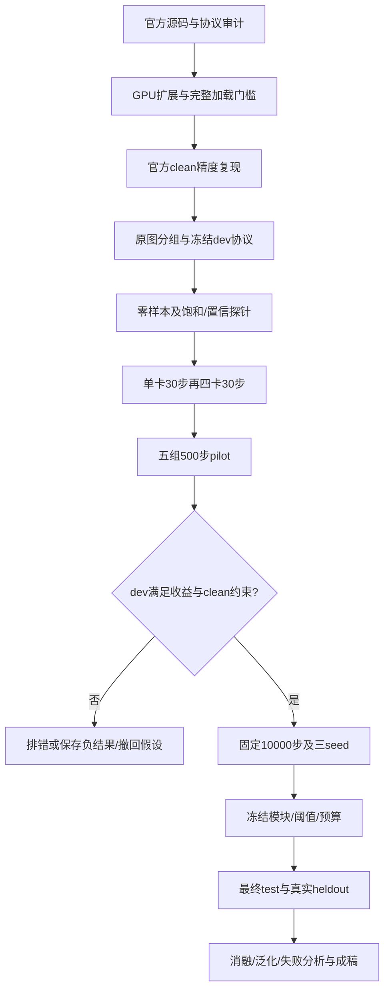

# 首项目研究方案：优先完成 FPN adapter 对照

## 决策与研究假设

用户已确认本轮只做本地软件验收，优先完成现有FPN adapter等预算对照。先不增加新的识别端/teacher损失。以下是可否证假设，不是已得到的结论。

H1：局部近饱和的**位置**能为多尺度FPN残差提供有用条件，其收益超过普通退化微调和等容量残差。H2：这种收益在可读文本上更明显，而不是靠不可读样本、阈值重调或更大训练预算。H3：confidence乘积造成的候选过滤和真正定位/识别错误应分开观察。

## 实现、理由与预期观察

| 模块 | 具体实现/改动 | 预期观察与否证条件 |
| --- | --- | --- |
| 数据/划分 | 原图/场景分组后再合成，保存来源哈希；clean同PNG | 排除编码/泄漏影响；跨split重复即不合格 |
| 普通微调 | 官方网络、混合退化、固定预算 | 是必须保留的强对照；若已解决问题，不能称adapter必要 |
| 容量对照 | 条件两通道置零，其余卷积与参数数完全一致 | 若与adapter持平，优势可能只是增加参数 |
| 饱和adapter | RGB反归一化；任意/全通道的连续近饱和图，area下采样，各FPN层零初始化残差 | 初始恒等；学习后应超容量对照，结果待测 |
| 全局条件/翻转条件 | 同容量网络，分别去掉位置或错置位置 | 如果与真实位置一样好，应撤回空间条件归因 |
| 按层消融 | `--levels`，只启用指定残差分支 | 定位受益层；不直接等价于检测/识别任务解耦 |
| 置信探针 | 对齐recognizer按FPN重排后的pre/post score | 判断候选是否只因识别置信下降被过滤，不等同于精度 |
| GT-crop接口 | 导出polygon饱和率、轴对齐crop、固定识别器预测评分 | 给独立识别诊断；未接曲线oracle，不据此宣称采样机制成立 |

默认四级adapter为68,224参数，几种条件模式参数总数相同。残差末层全零，初始化不会改变FPN输出。当前只接共享FPN路径；不会合成不存在的视觉笔画，严重信息丢失样本需要单独报告。

容量匹配指结构与**参数总数**匹配。zeros对照中连接两个恒零输入通道的256个权重不活跃，故不能据此宣称函数表达能力完全相同；报告时同时说明这部分占比，并结合global/flipped及普通微调共同判断，不能只靠一个对照支撑机制结论。

当前条件图取自增强、归一化、padding后的模型输入再反归一化，表示该输入的近饱和，不等同于RAW传感器剪裁或物理高光真值。上游ColorJitter可能改变其统计；先保留所有组相同的官方pipeline，再对所有对照配套做“保留/取消ColorJitter”的消融，不能只给目标模块换更有利的数据流。

## 证据链与退出规则

每次改动只验证一个主要假设，修改、预算、seed、初始化和数据哈希全部登记。pilot的排序只看dev；正式阶段预登记至少1.0个百分点的平均高光e2e增益、clean下降不超过0.5点、最严重档不倒退超过0.5点。合格线是值得继续投入的工程/研究标准，不是显著性保证。三seed均值、标准差和图像级配对统计再决定结论。

若adapter不胜residual，停止“显式饱和信息有效”的主张；若global/flip不差，停止“空间位置机制”的主张；若只改变confidence、不改善共同care实例的定位/文字，不能写采样修复；若只有合成集有效，不能写真实高光泛化。失败同样进入实验档案。

## 完整实验矩阵

1. 官方checkpoint原协议clean复现与固定协议零样本（必做）。
2. 官方初始化暴露登记；必要时另用pretrain初始化建立严格train-only clean对照。
3. 普通微调、容量匹配、饱和条件、global、flipped的500步pilot。
4. 主要三组10000步×3 seeds；条件位置和按层消融。
5. clean-only微调、通用退化增强、曝光校正前处理对照，均记录数据/预算差异。
6. 饱和占比、可读性、文本大小/长度分层；原始检测score与复合score；独立crop识别；失败图审查。
7. 第二数据集、真实heldout、第二架构：先接协议并验证matcher，再检验泛化，当前仍待实现。
8. 正式表格、冻结配置、负结果、数据许可、局限与复现包。

论文价值取决于证据链。亮度/雨雪/模糊用于OCR不是新颖性；adapter可训练也不是论文贡献成立。当前工作量按CCF-B实验完整性组织，但不承诺效果或录用。
